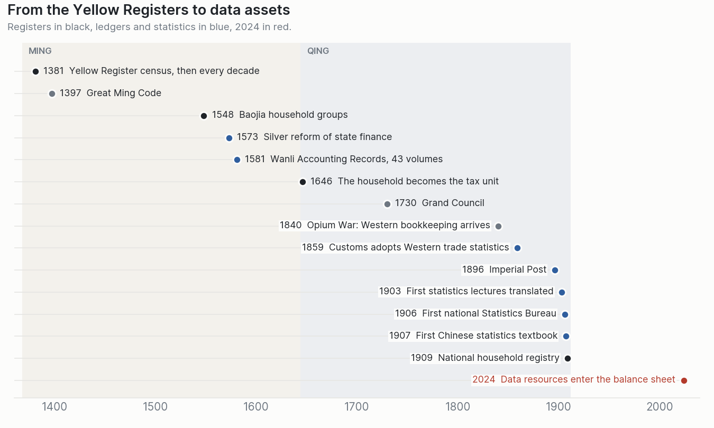
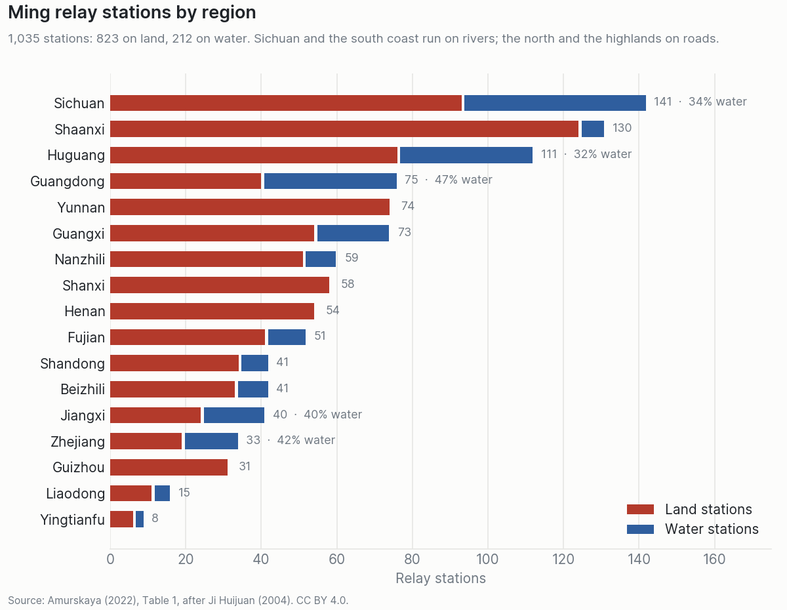
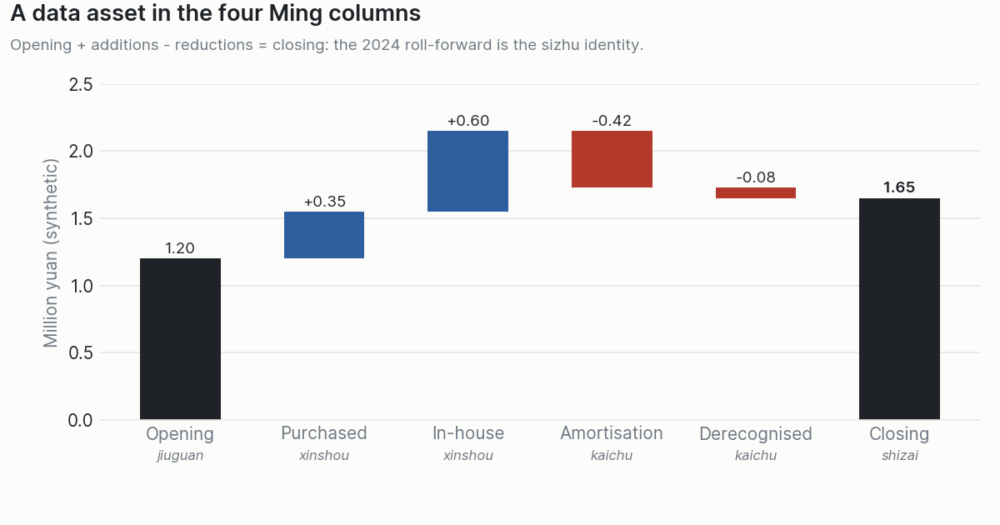

# Ming–Qing Ledgers: How Imperial China Counted Value

*Comment la Chine des Ming et des Qing comptait les foyers, l'argent et les stocks.*

<p align="center"></p>

## Research question

How did the Ming (1368–1644) and Qing (1644–1912) states record people, land, money and stock, and which of their accounting identities still run today?

## Findings

1. **The state ran on a closing identity.** The four-column report, *sizhu* 四柱 (opening + receipts − disbursements = closing), was the standard form from county to Ministry, monthly to triennially, for three centuries.
2. **Double entry grew locally.** Merchants' Dragon Gate (*longmen* 龙门账) and four-legged books computed profit twice, from flows and from stocks, and checked that both halves met, before Western bookkeeping arrived through the Maritime Customs.
3. **Statistics came with the household.** Registers counted households, not heads. The 1909 registry imputed population at a fixed 5.5 persons per household in the 18 provinces and 8.38 outside.
4. **The identity outlived the empire.** Since 2024, Chinese companies can carry data resources on the balance sheet, and an intangible-asset note is the same roll-forward. Old records explain the method; recent records carry the value for decisions.

<p>
  
  
</p>

## What's in this repository

| Path | Content |
|---|---|
| [`notebooks/ming_qing_ledgers.ipynb`](notebooks/ming_qing_ledgers.ipynb) | Checks the relay table, compares five ledger methods, runs the four-column and Dragon Gate identities in code, and maps the Ming columns onto a 2024 data-asset roll-forward |
| [`data/`](data/) | Six tables: `relay_stations`, `ledger_methods`, `registers`, `reporting_calendar`, `timeline`, `thinkers` (CSV; Parquet on [Hugging Face](https://huggingface.co/datasets/Kukai-7/ming-qing-ledgers)) |
| [`outputs/figures/`](outputs/figures/) | The three figures above |

## The two identities

```
Four columns  (state report)    opening + receipts − disbursements = closing
Dragon Gate   (merchant book)   receipts − payments = holdings − obligations
```

The first checks that what is on hand matches what was recorded. The second computes profit from flows and from stocks; both must "meet at the gate". The notebook runs both on a synthetic merchant year (profit 330 taels either way).

## Link to data valuation

This project is the historical side of [Industrial Data Valuation](https://github.com/Kukai-7/industrial-data-valuation). Valuing data starts with being able to book it: the 2024 provisions of China's Ministry of Finance put qualifying data resources under intangible assets or inventory, and the roll-forward that discloses them is the Ming *sizhu* identity.

## Sources

- Amurskaya, M. A. (2022). Accounting and statistics in China during the Ming dynasty. *Accounting. Analysis. Auditing*, 9(2), 72–81. [doi:10.26794/2408-9303-2022-9-2-72-81](https://doi.org/10.26794/2408-9303-2022-9-2-72-81). CC BY 4.0.
- Amurskaya, M. A. (2022). Accounting and statistics in China under the Qing dynasty. *Accounting. Analysis. Auditing*, 9(6), 61–70. [doi:10.26794/2408-9303-2022-9-6-61-70](https://doi.org/10.26794/2408-9303-2022-9-6-61-70). CC BY 4.0.
- Ministry of Finance of the PRC (2023). Interim Provisions on the Accounting Treatment of Enterprise Data Resources, in force 1 January 2024.

The relay table is transcribed from Table 1 of the Ming paper (after Ji Huijuan, 2004); the reporting calendar from its Table 2. The other tables are structured from the text of both papers.

## Known limits

- **One secondary source**, a synthesis of Chinese-language scholarship, read in translation. Names are romanised back to standard pinyin; some dates differ from other literature (the Grand Council is usually dated 1729 to 1733; Ming *baojia* is often linked to earlier local practice).
- **Yingtianfu** is listed apart from South Zhili in the source table; kept as published.
- **Synthetic sections.** The merchant year and the data-asset roll-forward illustrate the arithmetic; they are not historical or company accounts.

## Reproducibility

Python 3.13, packages in [`requirements.txt`](requirements.txt). No external data is read: `Run All` rebuilds every figure from `data/`.

```bash
pip install -r requirements.txt
jupyter nbconvert --to notebook --execute notebooks/ming_qing_ledgers.ipynb --inplace
```

## License

Code under the [MIT License](LICENSE). Text, figures and data under [CC BY 4.0](LICENSE-DATA.md), as are the source papers.
